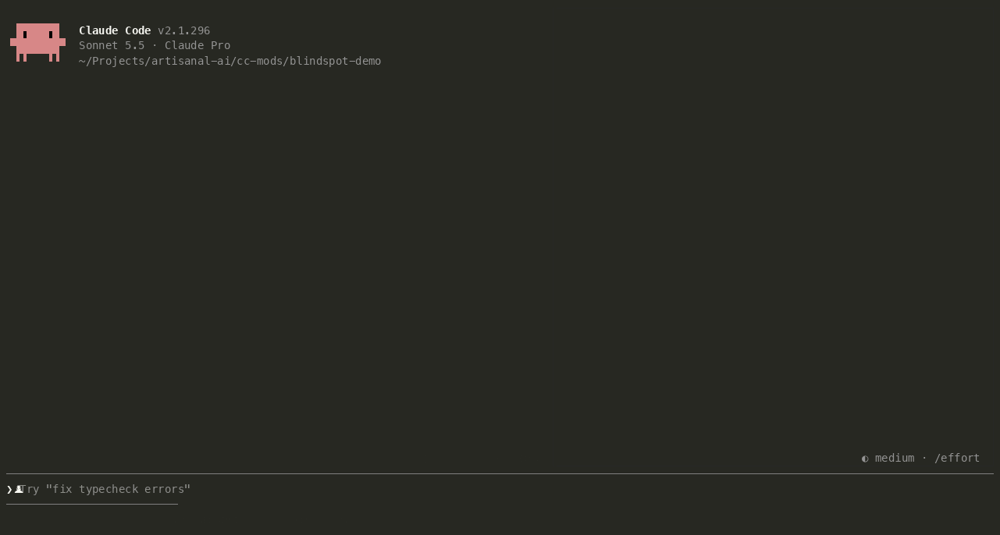

# blindspot

See where Claude looked, and what it didn't.

- **Blind spots.** Claude changes `formatMoney`. Nine files call it. Did it read
  them? After each turn, blindspot finds the files that use the function Claude
  changed but that Claude never opened, and shows each one with the line that
  uses it. Press `1` and Claude goes and checks them.
- **Attention map.** A live heatmap of your repo beside the transcript: every
  file a cell, lit by what Claude did with it (searched `▒`, read `▓`, edited
  `█`), blind spots in red.



## Install

blindspot lives in the [Artisanal AI marketplace](https://github.com/artisanal-ai/claude-plugins).
Inside Claude Code:

```
/plugin marketplace add artisanal-ai/claude-plugins
/plugin install blindspot@artisanal-ai
```

It starts with your next session. To update later:

```
/plugin marketplace update artisanal-ai
```

To remove it:

```
/plugin uninstall blindspot@artisanal-ai
```

## Use

The map opens beside the transcript by itself in a fullscreen terminal at least
144 columns wide. Otherwise run `/blindspot`.

When the blind-spot band shows:

| Key | Does |
| --- | --- |
| `1` | **Ask Claude to check them**: sends Claude the list and asks it to read each file and fix what broke |
| `2` | **Dismiss**: clears the band |
| `3` | **Map**: opens the attention map |

The digits work while the prompt is empty. You can also click the buttons, or
press `ctrl+x` `tab` to focus the band.

The band is about Claude's latest change, so blind spots don't pile up over a
long session:

- **Claude reads the lines** of the file that use the function: that blind
  spot clears.
- **Claude's next turn edits code**: its blind spots take the band's place,
  and older ones go. `/blindspot scan` brings back every one still open.
- **A turn with no edits**: each blind spot is checked again. It goes if the
  change was undone, or the file no longer uses the function. If the line
  moved, the band follows it.
- **The conversation is compacted**: Claude keeps only a summary, so what it
  read before counts as unread from now on. The map still shows it.
- **`/clear`**: a new conversation starts a new map.

### Commands

| Command | Does |
| --- | --- |
| `/blindspot` | Opens the attention map |
| `/blindspot scan` | Looks for blind spots now, across every file edited this session, in place of the band's |
| `/blindspot status` | Counts: files edited, read, seen; open blind spots |
| `/blindspot reset` | Clears the map |
| `/blindspot off` | Stops the blind-spot scans and hides the band and status line (the map keeps drawing) |
| `/blindspot on` | Starts them again |
| `/blindspot version` | The installed version |

## What counts

- **Read**: the lines Claude saw. The Read tool's page (`offset`, `limit`);
  in Bash, `head` and `tail` (their lines), `sed -n '10,20p'` (those lines),
  and the whole file for `cat`, `less`, `bat`, `nl`, `awk`, `sed` and
  `git show`/`blame`.
- **Edited**: Edit, MultiEdit, Write, NotebookEdit; in Bash, `sed -i`,
  `perl -i`, `> file`, `>> file`, `tee`, `mv`, `cp`, `rm`, `touch`, `git mv`/`rm`
  (files, not folders), even when the command fails afterwards.
- **Seen**: files in the output of Grep or Glob, or of `grep`, `rg`, `find`,
  `fd`, `ls` in Bash; files given to `diff`, `git diff`, or `sed -n` with a
  pattern. Bash paths follow `cd`.
- **Which function changed**: blindspot diffs each edited file against the
  working tree as it was just before Claude's first edit of the turn, so
  changes Claude stages or commits still count and yours from before don't.
  It finds the declaration each changed line sits in: `def`, `func`, `fn`,
  `function`, `class`, Java/C#/TypeScript methods and so on. A renamed or
  deleted function is looked for by its old name. A function used only inside
  its own file stands for the functions there that call it.
- **Who uses it**: see below.

blindspot needs a git repo. The map draws in the terminal.

## Languages

Blind spots work in any language, with nothing to install. blindspot searches
the repo for the changed function's name as a whole word, leaving out comment
lines, prose files (`.md`, `.txt`, logs) and names too common to mean anything
(`get`, `run`, `init`…). When
another file declares a function of the same name, only the files that can
see the changed one count: those in its folder, and those that name its
module (`from billing.money import`, `"./money"`, `#include "money.h"`).

If Claude Code happens to run a language server for the file (through a
language-server plugin such as `pyright-lsp`, with the server itself
installed), blindspot asks it instead: the same "Find All References" an
editor uses, which follows renamed imports exactly.

## Settings

Open `/config` and find the **blindspot** row **Open the map at start** (on by
default). It's kept in `settings.json` under
`pluginConfigs.blindspot.options.autoOpenPane`.

Colors follow your Claude Code theme. If the map draws dark in a light
terminal (seen in PyCharm with the theme on `auto`), set the theme to `light`
in `/config`.

## Make it yours

Run your own copy without installing it:

```sh
git clone https://github.com/artisanal-ai/blindspot.git
claude --plugin-dir ./blindspot
```

How the code is laid out:

```
hooks/
  register.tsx   The one file that talks to Claude Code: session state, the
                 hooks, the band and the map pane.
  blindspots.ts  Which functions changed, who uses them (name search, or a
                 language server when one runs), and which of those files
                 Claude never read.
  activity.ts    What a tool call read, edited or searched (Bash included).
  heatmap.ts     The map's grid: a row per folder, a cell per file, in theme colors.
  repo.ts        The repo and its files; paths as tools spell them.
  text.ts        Everything blindspot says: the prompt and the status line.
types/           blindspot's own data types.
tests/           `claude plugin test .`
```
